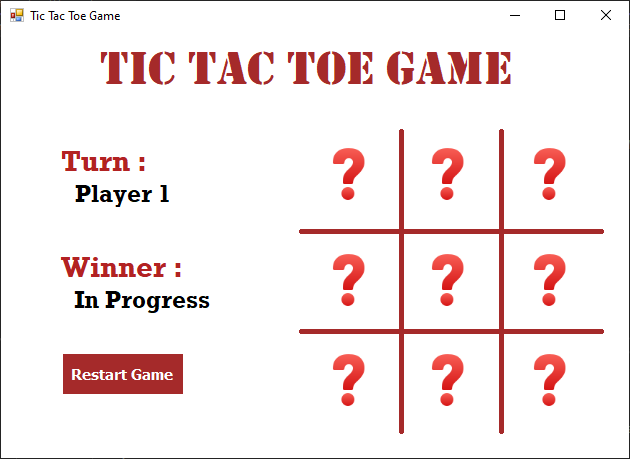
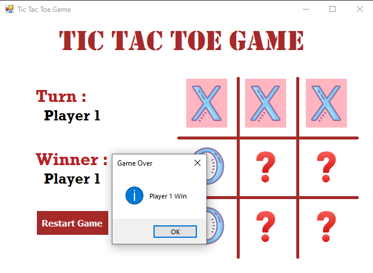
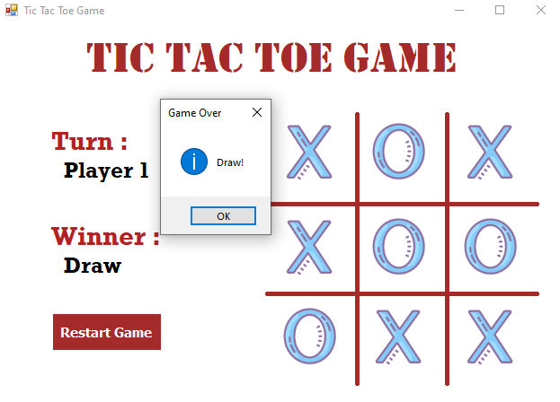

# ❌⭕ Tic-Tac-Toe Game (C# & Windows Forms)


A classic two-player **Tic-Tac-Toe (X-O)** desktop game built with **C#** and **Windows Forms**. The game board is rendered with **GDI+**, and the game state, turn management, and win/draw detection are all handled in clean, readable game logic.

---

## 📖 Overview

Two players take turns placing **X** and **O** on a 3×3 grid. The first player to line up three identical marks horizontally, vertically, or diagonally wins. If all nine cells are filled with no winner, the game ends in a draw.

The project is a hands-on exercise in event-driven programming, custom drawing with GDI+, and managing game state in a desktop application.

---

## ✨ Features

- 🎮 **Two-player turn system** — alternates automatically between **Player 1 (X)** and **Player 2 (O)**, with the current turn displayed on screen.
- 🖌️ **Custom grid drawing with GDI+** — the board lines are drawn in code using `Graphics.DrawLine` inside the `Paint` event, with round line caps and a custom pen.
- 🏆 **Winning line highlight** — the three winning cells are highlighted in **light pink**.
- ✅ **Automatic win & draw detection** — checks all 8 winning combinations (3 rows, 3 columns, 2 diagonals) after every move, and detects a draw after 9 moves.
- 🚫 **Invalid move prevention** — clicking an already-used cell shows an error message instead of overwriting it.
- 🔒 **Game lock on finish** — no further moves are accepted once the game is over.
- 🔄 **Restart button** — resets the board, turn indicator, status label, and game state in one click.
- 🧩 **Reusable logic** — a single shared click handler (`Box_Click`) serves all nine `PictureBox` cells, and helper methods (`ResetPicBox`, `CheckValues`) keep the code DRY.

---

## 🛠️ Tech Stack

| Technology | Usage |
|---|---|
| **C#** | Core language and game logic |
| **.NET** | Application framework |
| **Windows Forms (WinForms)** | Desktop UI (`Form`, `PictureBox`, `Label`, `Button`) |
| **GDI+ (System.Drawing)** | Custom drawing of the game grid |
| **Visual Studio** | IDE and build tooling |

---

## 🚀 Getting Started

### Prerequisites

- **Windows** operating system
- **Visual Studio 2019 / 2022** with the **".NET desktop development"** workload installed

### How to Run

1. **Clone the repository**
   ```bash
   git clone https://github.com/<your-username>/<your-repo-name>.git
   ```
2. **Open the solution** — double-click the `.sln` file to open it in Visual Studio.
3. **Restore & build** — press `Ctrl + Shift + B` (or *Build → Build Solution*).
4. **Run the game** — press `F5` (debug) or `Ctrl + F5` (without debugging).
5. **Play!** — Player 1 (X) starts. Click any empty cell to place your mark.

---

## 📸 Screenshots

| Gameplay | Winning Line | Draw |
|:---:|:---:|:---:|
|  |  |  |

---

## 🧠 How It Works

- **Game state** is tracked with `isPlayer1Turn`, `gameOver`, and `moveCount`.
- Each cell is a `PictureBox` whose `Tag` stores its value (`""`, `"X"`, or `"O"`), which makes win checking simple and fast.
- `CheckValues()` compares three cells at a time, and `CheckWinner()` calls it for every winning combination.
- The grid lines are painted in `Game_Paint`, so no image assets are needed for the board itself.

---

## 🔮 Future Improvements

- 🤖 **Play against the computer** — add a single-player mode with an AI opponent (random → Minimax algorithm for an unbeatable bot).
- 📊 **Scoreboard** — track wins for Player 1, Player 2, and draws across multiple rounds.
- 👤 **Custom player names** — let players enter their names instead of "Player 1" / "Player 2".
- 🎨 **Themes & sound effects** — dark mode, custom X/O skins, and click/win sounds.
- 🧪 **Refactoring & tests** — separate the game logic from the UI (e.g., a `GameBoard` class) so it can be unit tested.
- 🌐 **Online multiplayer** — play with a friend over a network.

---

## 🤝 Contributing

Contributions, issues, and feature requests are welcome! Feel free to open an issue or submit a pull request.

## 📄 License

This project is open source and available under the [MIT License](LICENSE).

---

<p align="center">Made with ❤️ using C# and Windows Forms</p>
